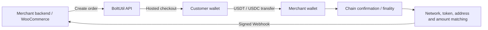

# BoltUtil v2.1

[English](README.md) · [简体中文](README.zh-CN.md) · [Español](README.es.md) · [Português](README.pt-BR.md) · [Русский](README.ru.md) · [Tiếng Việt](README.vi.md) · [Türkçe](README.tr.md) · [日本語](README.ja.md) · [한국어](README.ko.md) · [العربية](README.ar.md) · [Français](README.fr.md) · [हिन्दी](README.hi.md)

## USDT & USDC payments. Direct to your wallet.

**A non-custodial stablecoin payment API and hosted checkout for websites, SaaS products and WooCommerce stores.** Accept payments across **six networks**, including **Base**, with connected-wallet checkout, manual transfer and signed payment Webhooks.

[](https://boltutil.com?utm_source=github&utm_medium=referral&utm_campaign=boltutil_v21&utm_content=readme)
[](https://boltutil.com/features?utm_source=github&utm_medium=referral&utm_campaign=boltutil_v21&utm_content=readme)
[](https://boltutil.com/docs/base-integration?utm_source=github&utm_medium=referral&utm_campaign=boltutil_v21&utm_content=readme)
[](https://github.com/changye0413/BoltUtil/actions/workflows/examples.yml)

[**Start free**](https://boltutil.com/auth/register?utm_source=github&utm_medium=referral&utm_campaign=boltutil_v21&utm_content=start) · [**API documentation**](https://boltutil.com/developer-docs?utm_source=github&utm_medium=referral&utm_campaign=boltutil_v21&utm_content=docs) · [**Try checkout interactions**](https://boltutil.com/?utm_source=github&utm_medium=referral&utm_campaign=boltutil_v21&utm_content=checkout-demo#wallet-checkout) · [**WooCommerce demo shop**](https://shop-test.boltutil.com/) · [**Download the plugin**](https://github.com/changye0413/boltutil-payments-for-woocommerce/releases/tag/v0.6.1)

Create an order from your backend. Your customer pays the merchant’s receiving wallet. BoltUtil matches the on-chain transfer, waits for the required confirmation or finality, then sends a signed Webhook so your application can fulfill the order.


*Screenshot of the live website’s interactive demonstration. The illustrated address and QR code are not payment instructions. The separate demo shop supports real small purchases: payments there use real funds.*

## What changed in v2.1?

| Capability | What it means for your integration |
| --- | --- |
| USDT + USDC | One order API, with explicit network and token selection |
| Base payments | Native USDC and the configured Bridged USDT variant on Base |
| Wallet checkout | Address, network and exact amount filled in; customer reviews and confirms |
| Manual transfer | QR code, copyable address and exact amount remain available |
| Payment operations | Confirmation tracking, transaction hashes, order timelines, signed Webhook delivery logs and retries |
| WooCommerce | Separate open-source v0.6.1 plugin with token switching and eligible network choices |
| Localization | Website UI and these product guides in 12 languages |

This repository is the **public integration hub**, not the production platform source. The hosted BoltUtil service is proprietary. See [repository scope](NOTICE.md). The service version **v2.1**, plugin version **v0.6.1** and public documentation updates are separate.

## Supported stablecoins and networks

Six networks provide **eleven asset/network combinations**. Routes appear only when enabled by the service and backed by an active merchant receiving wallet.

| API `network` | Blockchain | USDT | USDC |
| --- | --- | --- | --- |
| `TRC20` | TRON | TRC20 USDT | Not supported |
| `ERC20` | Ethereum | ERC20 USDT | Native USDC |
| `BEP20` | BNB Smart Chain | BEP20 USDT | Binance-Peg USDC |
| `POLYGON` | Polygon PoS | Configured USDT contract | Native USDC |
| `SOLANA` | Solana | SPL-USDT | Native SPL-USDC |
| `BASE` | Base | Bridged USDT | Native USDC |

**Token identity matters.** Native, bridged and pegged tokens are different assets even when wallet labels look similar. Use the contract or mint supported by the selected checkout route. Other USDC representations are not interchangeable. TRON USDC is not offered.

[USDC integration guide](https://boltutil.com/docs/usdc-integration?utm_source=github&utm_medium=referral&utm_campaign=boltutil_v21&utm_content=readme) · [Base integration guide](https://boltutil.com/docs/base-integration?utm_source=github&utm_medium=referral&utm_campaign=boltutil_v21&utm_content=readme) · [Network availability](https://boltutil.com/features?utm_source=github&utm_medium=referral&utm_campaign=boltutil_v21&utm_content=readme)

Base payment confirmation depends on the configured L1 finality policy. A submitted transfer is not yet a confirmed payment; no fixed confirmation time is promised.

## Wallet checkout: less typing, explicit approval

The customer selects **Pay with your wallet**. The checkout prepares the recipient, asset, network and exact amount from the order. The customer connects a supported wallet and approves the transaction in that wallet. **Manual transfer** is available in the same checkout as an alternative.

Current wallet entrances include **MetaMask, OKX Wallet, Trust Wallet, Phantom, TronLink, Bitget Wallet, Binance Wallet, TokenPocket, SafePal and Base app** (formerly Coinbase Wallet). This is an integration list, not a global popularity ranking or endorsement.

- Available options depend on the order’s network, device and installed providers. Not every wallet supports every route.
- MetaMask and OKX use native remote connection flows where supported. Other entrances open the same checkout in the wallet’s app browser; SafePal and Base app offer instructions to open the order URL there.
- An app-browser handoff is different from pairing the phone with a desktop session. Not all wallets offer desktop QR pairing.
- Connecting a wallet does **not** send funds. First use may also require unlocking, authorizing connection or switching networks.
- Network fees require the chain’s native currency. Wallet approval and broadcasting are separate from BoltUtil’s confirmed payment result.

The checkout filters unsupported combinations. Phantom’s BNB connection is excluded; WalletConnect is optional and requires a configured connection service, so it is not promised on every checkout.

## Quick start for developers

1. [Create a merchant account](https://boltutil.com/auth/register?utm_source=github&utm_medium=referral&utm_campaign=boltutil_v21&utm_content=start).
2. Add and enable receiving **addresses** for your intended networks and assets. No private key or recovery phrase is required by BoltUtil.
3. Create a LIVE API key and an HTTPS Webhook endpoint in the same merchant account. Keep the matching signing secret on your server.
4. Create a payment order and redirect to the returned `checkoutUrl`.
5. Display `payment.amount` exactly. Do not round it or replace it with your original product price.
6. Verify the Webhook signature, timestamp, order identity, asset, network and payment result before fulfillment. Make fulfillment idempotent.
7. Use the order-status API and dashboard delivery logs for reconciliation.

### Create a Base USDC payment order

```http
POST https://api.boltutil.com/api/v1/order/create
Content-Type: application/json
X-Bolt-Key: YOUR_LIVE_API_KEY
X-Bolt-Timestamp: CURRENT_UNIX_TIME_IN_MILLISECONDS
X-Bolt-Signature: HMAC_SHA256_HEX(timestamp + "." + exact_raw_json_body, webhook_secret)
```

```json
{
  "externalOrderId": "ORDER-10001",
  "amount": 49.90,
  "currency": "USDC",
  "network": "BASE",
  "notifyUrl": "https://merchant.example.com/webhooks/boltutil",
  "returnUrl": "https://merchant.example.com/orders/10001"
}
```

The response includes `orderToken`, `merchantExternalId`, `checkoutUrl`, `payment` and `time`. Treat `payment.amount` as a decimal string. Its precise value can differ from the requested amount because BoltUtil allocates amounts for matching concurrent orders; the service’s returned value is authoritative.

The request minimum is 1, with up to six fractional digits. Sign the exact body bytes you send and generate a fresh timestamp for each request. No live USD conversion quote is implied by the example.

[Create-order reference](https://boltutil.com/docs/create-order?utm_source=github&utm_medium=referral&utm_campaign=boltutil_v21&utm_content=readme) · [Query order status](https://boltutil.com/docs/order-status?utm_source=github&utm_medium=referral&utm_campaign=boltutil_v21&utm_content=readme) · [Verify Webhook signatures](https://boltutil.com/docs/webhook-signature?utm_source=github&utm_medium=referral&utm_campaign=boltutil_v21&utm_content=readme)

Import [OpenAPI](openapi.yaml) or the [Postman collection](postman/BoltUtil.postman_collection.json). The examples below retain USDT defaults; choose an authorized USDC/network pair when adapting them. They illustrate merchant integration, not a complete fulfillment system.

| Language | Create order and verify Webhook |
| --- | --- |
| Node.js | [Example](examples/node/boltutil-demo.js) |
| Python | [Example](examples/python/boltutil_demo.py) |
| PHP | [Example](examples/php/boltutil_demo.php) |
| Go | [Example](examples/go/boltutil_demo.go) |
| Java | [Example](examples/java/BoltUtilDemo.java) |
| C# | [Example](examples/csharp/BoltUtilDemo.cs) |

[Run commands and environment variables](examples/README.md). Never put merchant secrets in frontend code, mobile bundles, public issues or Git history.

## WooCommerce USDT / USDC plugin

[**BoltUtil Payments for WooCommerce v0.6.1**](https://github.com/changye0413/boltutil-payments-for-woocommerce) lets customers choose a token, then an eligible network before continuing to Hosted Checkout. The plugin verifies signed callbacks and merchant-scoped API status before updating the WooCommerce order. A browser return does not mark an order paid.

Requirements: WordPress **7.0+**, PHP **7.4+**, WooCommerce **11.1+**, HTTPS and a store currency of **USD**. The USD numeric total is the invoice basis; this plugin does not provide a live exchange-rate quote or lock. Customer network fees are separate.

[Installable ZIP and release notes](https://github.com/changye0413/boltutil-payments-for-woocommerce/releases/tag/v0.6.1) · [Setup guide](https://boltutil.com/woocommerce?utm_source=github&utm_medium=referral&utm_campaign=boltutil_v21&utm_content=woocommerce) · [Live demo store](https://shop-test.boltutil.com/)

Submitted to WordPress.org on **October 12, 2026**. Automated submission scan: **Pass**. Status: **awaiting manual review**, not directory approval. Until approved and published, install the versioned ZIP from GitHub Releases; GitHub source archives are not the install package.

## Payment correctness and operations



- Match the order’s exact network, token contract or mint, recipient, amount, validity window and confirmation requirements.
- Validate `X-Bolt-Webhook-Signature` over the raw body and check `X-Bolt-Webhook-Timestamp` for freshness.
- Treat delivery retries as duplicate-capable events; fulfill a local order only once.
- Review short, excess, late or ambiguous payments in the merchant workflow. Underpayment is not automatically payment success.
- Dashboard payment-source labels record reported method, wallet and connection type when available. The label is auxiliary information, not on-chain proof or a settlement signal.

## Who is it for?

**SaaS and AI tools:** sell subscriptions or credits, then activate service after verified payment. **Digital products:** deliver licenses or downloads through a confirmed order. **Ecommerce:** add stablecoin checkout to a WooCommerce store. **Cross-border invoices:** connect a transaction hash to your own invoice while retaining control of the receiving wallet.

BoltUtil handles payment monitoring and notifications. It is not an exchange, a pooled settlement account or a wallet custodian, and does not provide automatic fiat conversion.

## Plans, documentation and support

A daily free order allowance is available. Subscription plans have no daily order limit. **Current quotas, benefits and fees are governed by the [official pricing page](https://boltutil.com/pricing?utm_source=github&utm_medium=referral&utm_campaign=boltutil_v21&utm_content=pricing)**, rather than a fixed number in this README. Network gas fees still apply.

- [Developer documentation](https://boltutil.com/developer-docs?utm_source=github&utm_medium=referral&utm_campaign=boltutil_v21&utm_content=docs) and [system status](https://boltutil.com/status?utm_source=github&utm_medium=referral&utm_campaign=boltutil_v21&utm_content=readme).
- [GitHub Discussions](https://github.com/changye0413/BoltUtil/discussions) for integration questions; [Issues](https://github.com/changye0413/BoltUtil/issues/new/choose) for reproducible documentation/example problems.
- [support@boltutil.com](mailto:support@boltutil.com) for account and payment support; [X: @heyharryzhang](https://x.com/heyharryzhang) for updates.
- [Privacy](https://boltutil.com/privacy?utm_source=github&utm_medium=referral&utm_campaign=boltutil_v21&utm_content=readme) · [Terms](https://boltutil.com/terms?utm_source=github&utm_medium=referral&utm_campaign=boltutil_v21&utm_content=readme) · [Security reporting](SECURITY.md).

These 12-language guides share the same asset and service scope. The [English guide](README.md) and linked API reference are the technical baseline. Public docs and examples use [MIT](LICENSE); the separate WooCommerce plugin uses GPLv2 or later. Brand names and logos identify integrations and do not imply endorsement. The license for this repository does not grant rights to the proprietary platform or its trademarks.
