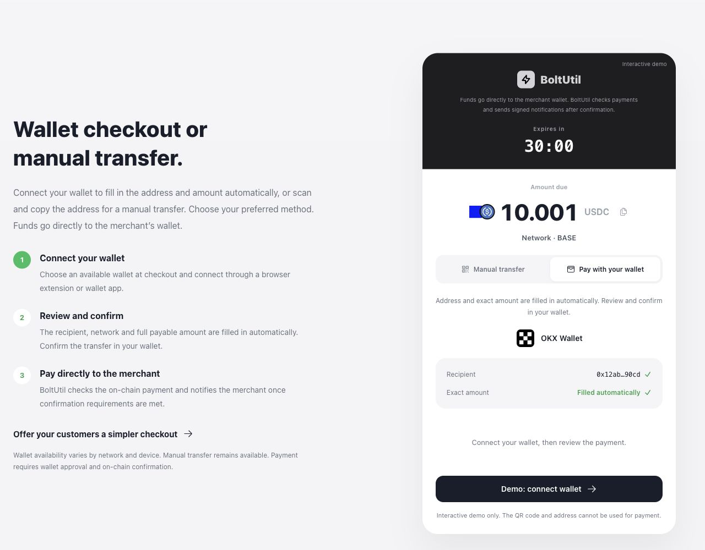

# BoltUtil v2.1

[English](README.md) · [简体中文](README.zh-CN.md) · [Español](README.es.md) · [Português](README.pt-BR.md) · [Русский](README.ru.md) · [Tiếng Việt](README.vi.md) · [Türkçe](README.tr.md) · [日本語](README.ja.md) · [한국어](README.ko.md) · [العربية](README.ar.md) · [Français](README.fr.md) · [हिन्दी](README.hi.md)

## USDT / USDC 收款，资金直达您的钱包

**BoltUtil 是面向网站、SaaS、数字产品和 WooCommerce 商店的非托管稳定币支付 API 与托管收银台。** 一套接入覆盖 **六条网络**，包含 **Base**，提供钱包快捷支付、手动转账、链上核对和签名 Webhook。

[**免费开始**](https://boltutil.com/zh/auth/register?utm_source=github&utm_medium=referral&utm_campaign=boltutil_v21&utm_content=start) · [**开发者文档**](https://boltutil.com/zh/developer-docs?utm_source=github&utm_medium=referral&utm_campaign=boltutil_v21&utm_content=docs) · [**体验收银台交互**](https://boltutil.com/zh?utm_source=github&utm_medium=referral&utm_campaign=boltutil_v21&utm_content=checkout-demo#wallet-checkout) · [**WooCommerce 演示店**](https://shop-test.boltutil.com/) · [**下载插件**](https://github.com/changye0413/boltutil-payments-for-woocommerce/releases/tag/v0.6.1)

商户后端创建订单，用户向商户配置的收款地址付款。BoltUtil 匹配链上转账并等待确认或最终性，再发送带签名的回调，由您的业务系统发货、充值或开通服务。BoltUtil 不要求私钥、助记词或提币权限。



*图片来自线上官网的交互演示，展示地址与二维码不能用于付款。独立演示商店允许真实小额购买，付款会使用真实资金。*

## v2.1 的主要能力

| 能力 | 对商户与用户的意义 |
| --- | --- |
| USDT + USDC | 同一个建单接口，明确选择币种和网络 |
| Base 支持 | 接收原生 USDC 与平台配置的桥接 USDT |
| 钱包快捷支付 | 自动填入地址、网络和准确金额，用户在钱包核对并确认 |
| 手动转账 | 保留二维码、复制地址与完整应付金额，可切换使用 |
| 支付运维 | 链上确认、交易哈希、订单时间线、回调日志、失败重试与人工核对 |
| WooCommerce | 独立开源 v0.6.1 插件，先切换币种，再显示可用网络 |
| 多语言 | 官网界面和本仓库产品指南提供 12 种语言 |

本仓库是**公开产品说明与商户集成入口**，不是生产平台源码。BoltUtil 托管服务属于闭源商业系统。[仓库范围](NOTICE.md)。服务 **v2.1**、插件 **v0.6.1** 和公开文档版本分别维护。

## 六条链与十一种支付组合

| API `network` | 网络 | USDT | USDC |
| --- | --- | --- | --- |
| `TRC20` | TRON | TRC20 USDT | 不支持 |
| `ERC20` | Ethereum | ERC20 USDT | 原生 USDC |
| `BEP20` | BNB Smart Chain | BEP20 USDT | Binance-Peg USDC |
| `POLYGON` | Polygon PoS | 平台配置的 USDT 合约 | 原生 USDC |
| `SOLANA` | Solana | SPL-USDT | 原生 SPL-USDC |
| `BASE` | Base | Bridged USDT | 原生 USDC |

支付通道必须经过平台启用，并有商户已启用的收款地址。**原生、桥接和锚定代币不是同一种资产**，不能仅凭钱包中的简称转账；请使用订单指定的合约或 Mint。TRON 不提供 USDC。

[USDC 接入指南](https://boltutil.com/zh/docs/usdc-integration?utm_source=github&utm_medium=referral&utm_campaign=boltutil_v21&utm_content=readme) · [Base 接入指南](https://boltutil.com/zh/docs/base-integration?utm_source=github&utm_medium=referral&utm_campaign=boltutil_v21&utm_content=readme) · [产品功能](https://boltutil.com/zh/features?utm_source=github&utm_medium=referral&utm_campaign=boltutil_v21&utm_content=readme)

Base 付款需满足配置的 L1 最终确认条件。发出交易不等于订单已确认，也不承诺固定到账时长。

## 钱包快捷支付：减少输入，保留用户确认

用户在收银台切换到**钱包快捷支付**，收款地址、币种、网络和准确金额由订单自动填入。用户连接钱包，在钱包中核对后确认交易。也可切回**手动转账**，扫码或复制地址，填写完整金额。

目前入口覆盖 **MetaMask、OKX Wallet、Trust Wallet、Phantom、TronLink、Bitget Wallet、Binance Wallet、TokenPocket、SafePal、Base app（原 Coinbase Wallet）**。这是接入范围，不是全球热度排名，也不代表钱包官方背书。

- 具体入口随订单网络、设备、扩展与内置浏览器变化，不是每款钱包都支持所有链。
- MetaMask、OKX 在支持的场景使用原生远程连接；其他入口主要在钱包 App 浏览器打开同一收银台，SafePal、Base app 提供打开订单链接的说明。
- 在 App 内打开订单与“手机和桌面会话配对”不同，不能理解为所有钱包均支持桌面扫码配对。
- **连接钱包不会自动转账。** 首次使用还可能需要解锁、授权连接、切链；付款仍由用户确认。
- 网络手续费需准备对应原生币，交易广播与 BoltUtil 核验成功是不同阶段。

收银台会过滤不支持的组合，例如 Phantom 的 BNB 连接。通用 WalletConnect 是可选能力，需要配置连接服务，不保证每个收银台都有。

## 开发者快速接入

1. [注册商户账号](https://boltutil.com/zh/auth/register?utm_source=github&utm_medium=referral&utm_campaign=boltutil_v21&utm_content=start)，为目标网络与币种添加并启用收款**地址**。
2. 创建 LIVE API Key，并在同一商户账号配置 HTTPS Webhook，服务端保存对应签名密钥。
3. 后端创建订单，引导用户打开返回的 `checkoutUrl`。
4. 展示 `payment.amount` 的完整值，不自行四舍五入，也不拿原商品价格替代。
5. 验证回调签名、时间戳、订单、币种、网络和付款结果，再履约；履约必须幂等。
6. 用查询接口与后台投递日志进行补查、重试和核对。

### 创建 Base USDC 订单

```json
{
  "externalOrderId": "ORDER-10001",
  "amount": 49.90,
  "currency": "USDC",
  "network": "BASE",
  "notifyUrl": "https://merchant.example.com/webhooks/boltutil",
  "returnUrl": "https://merchant.example.com/orders/10001"
}
```

请求地址：`POST https://api.boltutil.com/api/v1/order/create`。请求头包含 `X-Bolt-Key`、当前毫秒时间戳 `X-Bolt-Timestamp`、`X-Bolt-Signature`。签名为对应 Webhook Secret 对 `timestamp + "." + 原始 JSON 请求体` 的 HMAC-SHA256 十六进制结果，签名后发送相同原始字节。

响应包含 `orderToken`、`merchantExternalId`、`checkoutUrl`、`payment` 和 `time`。应付金额 `payment.amount` 是字符串，为区分同时待付订单可能与提交金额略有不同，以返回值为准。请求金额最低为 1，最多六位小数；示例不代表实时美元兑换报价。

[建单文档](https://boltutil.com/zh/docs/create-order?utm_source=github&utm_medium=referral&utm_campaign=boltutil_v21&utm_content=readme) · [查询订单](https://boltutil.com/zh/docs/order-status?utm_source=github&utm_medium=referral&utm_campaign=boltutil_v21&utm_content=readme) · [回调验签](https://boltutil.com/zh/docs/webhook-signature?utm_source=github&utm_medium=referral&utm_campaign=boltutil_v21&utm_content=readme)

本仓库提供 Node.js、Python、PHP、Go、Java、C# 示例、[OpenAPI](openapi.yaml) 和 [Postman](postman/BoltUtil.postman_collection.json)。[运行说明](examples/README.md)。各语言示例保留 USDT 默认值，接入 USDC 时改用实际启用的币种/网络组合。示例不是完整业务履约系统，不应将密钥放入前端或公开仓库。

## WordPress / WooCommerce 插件

[**BoltUtil Payments for WooCommerce v0.6.1**](https://github.com/changye0413/boltutil-payments-for-woocommerce) 支持切换 USDT/USDC 和选择可用网络，再跳转收银台。插件验证签名回调并查询商户范围内的付款状态后才更新 WooCommerce 订单；返回商店页面不等于支付成功。

要求：WordPress **7.0+**、PHP **7.4+**、WooCommerce **11.1+**、HTTPS、商店币种为 **USD**。美元数值总价作为稳定币账单基准，插件不提供实时兑换报价或汇率锁定，用户网络手续费单独计算。

[安装包](https://github.com/changye0413/boltutil-payments-for-woocommerce/releases/tag/v0.6.1) · [配置说明](https://boltutil.com/zh/woocommerce?utm_source=github&utm_medium=referral&utm_campaign=boltutil_v21&utm_content=woocommerce) · [演示店](https://shop-test.boltutil.com/)

**2026 年 10 月 12 日已提交 WordPress.org，提交自动扫描通过，当前等待人工审核，尚未宣称获批上架。** 获批发布前从 GitHub Release 下载版本 ZIP；GitHub 自动生成的源码 ZIP 不是插件安装包。

## 金额、回调与核对

- 转账须匹配订单的链、代币合约/Mint、地址、金额、有效期和确认条件。
- 使用原始请求体验证 `X-Bolt-Webhook-Signature`，检查 `X-Bolt-Webhook-Timestamp`，避免接受过期通知。
- 回调可能重试，您的本地订单不能重复发货或入账。
- 少付、多付、迟到和归属不明的付款进入商户核对流程，少付不会自动视为成功。
- 后台可记录付款方式、钱包名称和连接方式；这些来源标签属于辅助信息，不是链上证明，也不能触发结算。

## 适用场景与套餐

SaaS 订阅、AI 工具积分、数字产品下载、软件授权、游戏充值、WooCommerce 电商与跨境账单，都可通过后端建单、确认付款、签名回调与幂等履约接入。BoltUtil 不是交易所、托管钱包或资金归集账户，也不提供自动法币转换。

每天提供免费订单额度，订阅套餐不限每日订单数。**具体额度、权益和费用以[官网定价](https://boltutil.com/zh/pricing?utm_source=github&utm_medium=referral&utm_campaign=boltutil_v21&utm_content=pricing)最新说明为准**，本仓库不写死每日单量；链上手续费仍然存在。

## 文档、帮助与许可

[开发者文档](https://boltutil.com/zh/developer-docs?utm_source=github&utm_medium=referral&utm_campaign=boltutil_v21&utm_content=docs) · [系统状态](https://boltutil.com/zh/status?utm_source=github&utm_medium=referral&utm_campaign=boltutil_v21&utm_content=readme) · [隐私](https://boltutil.com/zh/privacy?utm_source=github&utm_medium=referral&utm_campaign=boltutil_v21&utm_content=readme) · [服务条款](https://boltutil.com/zh/terms?utm_source=github&utm_medium=referral&utm_campaign=boltutil_v21&utm_content=readme)

集成讨论使用 [Discussions](https://github.com/changye0413/BoltUtil/discussions)，可复现的文档/示例问题使用 [Issues](https://github.com/changye0413/BoltUtil/issues/new/choose)。账户或付款问题联系 [support@boltutil.com](mailto:support@boltutil.com)，关注 [X：@heyharryzhang](https://x.com/heyharryzhang)。安全问题按照 [SECURITY.md](SECURITY.md) 私下报告，不公开密钥、私钥或助记词。

12 种语言介绍保持一致的资产与服务范围，技术细节以[英文主文档](README.md)及 API 参考为基准。公开文档和示例采用 [MIT](LICENSE)，独立 WooCommerce 插件采用 GPLv2 or later。公开许可证不适用于闭源平台与商标；钱包和链名称用于标识集成，不代表官方背书。
